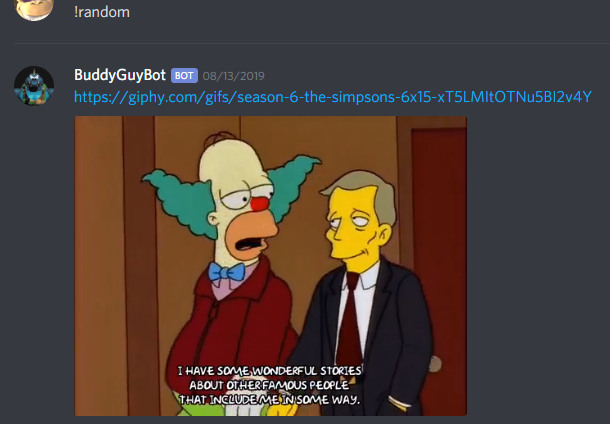
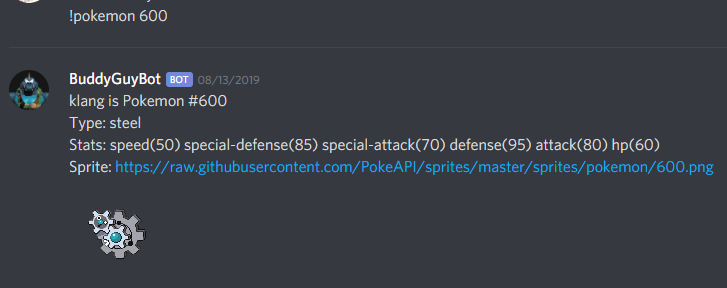
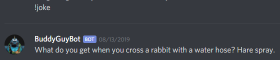
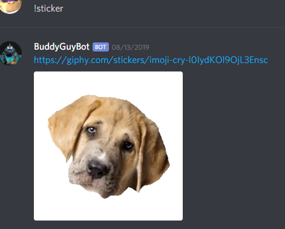
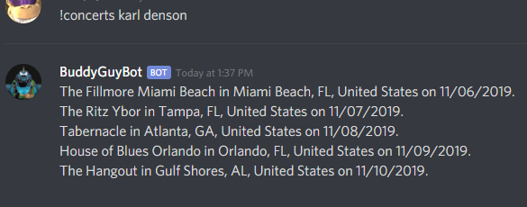
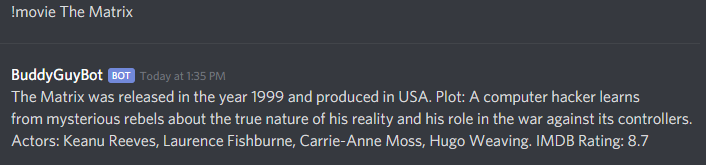
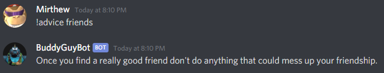
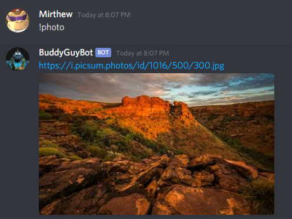
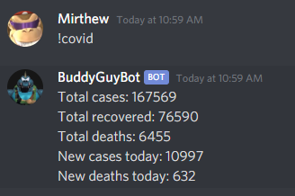
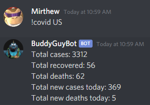

# BuddyGuyBot

## Description

A discord bot that queries various APIs in response to the commands described here.

## Initial Setup

Create a .env file that holds all of your API keys. You will need these keys, formatted like so --

DISCORD_TOKEN=YOUR_KEY_HERE
DARK_SKY_KEY=YOUR_KEY_HERE
GIPHY_KEY=YOUR_KEY_HERE

## Commands

### !random



Finds and posts a random gif from giphy.

### !pokemon NUMBER or NAME



Uses a Pokemon API to find and post information about a pokemon.

### !joke



Queries the icanhazdadjoke or official-joke-api API to post a joke to the chat.

### !sticker



Finds a sticker from giphy.

### !concerts BAND_NAME



Searches for upcoming concerts and posts them.

### !movie MOVIE_NAME



Posts information about a movie.

### !catfact

Gets a catfact from the [Cat Fact API](https://alexwohlbruck.github.io/cat-facts/)!

### !insult

Gets an insult from the [Evil Insult Generator](https://evilinsult.com/api/).

### !advice

Retrieves an advice slip from the [Advice Slip API](https://api.adviceslip.com/). If a topic is provided, then it will search for advice based on that topic.

For example: `!advice friends`



### !photo

Queries lorem picsum and unsplash to send a pleasant, random 500 x 300 pixel photo to the chat.



### !covid

Without parameters, it will provide global statistics for the Covid-19 pandemic.



With a 2-letter country code passed in, it will provide stats for that country.



## Running with Docker

For an easier setup that manages dependencies like Node.js, npm, and Playwright, you can run the bot using Docker.

1.  **Prepare your environment file**: Create a file named `local.env` in the project root directory (`/path/to/BuddyGuyBot/local.env`). Add your environment variables to this file, ensuring the Discord bot token is named exactly `BOT_TOKEN`. Other variables from your original `.env` (like `DARK_SKY_KEY`, `GIPHY_KEY`) might also be needed depending on other commands, but for the core functionality and the `fplDeadline` command, `BOT_TOKEN` is crucial.
    ```
    BOT_TOKEN=your_discord_bot_token_here
    DARK_SKY_KEY=your_dark_sky_key_here
    GIPHY_KEY=your_giphy_key_here
    ```
    **Important:** Do not commit this `local.env` file to version control. It contains sensitive information.

2.  **Install Docker and Docker Compose**: Ensure you have both [Docker](https://docs.docker.com/get-docker/) and [Docker Compose](https://docs.docker.com/compose/install/) installed on your system.

3.  **Build and run the container**:
    From the project root directory, run the following command:
    ```bash
    docker-compose up -d
    ```
    This command will build the Docker image (if it hasn't been built already) and start the bot container in detached mode.

4.  **Stopping the container**:
    To stop the running container, run:
    ```bash
    docker-compose down
    ```

The container will automatically install Playwright's required browser dependencies during the image build process, resolving errors like "Executable doesn't exist at ...".